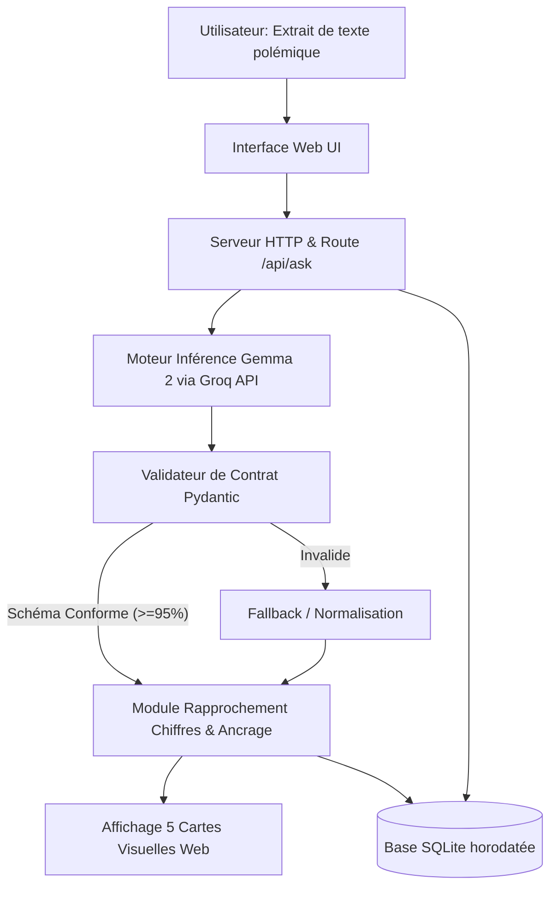

# JALON 2 — LA CONCEPTION DE LA SOLUTION
**Projet :** Assistant pédagogique d’esprit critique et de déconstruction d’arguments (PFE ECE 2026-2027)  
**Équipe :** Aurelien Jacson, Bryan Tachi Yemelong, Suzy Cassandra Ebobisse, Timothée Wyrzykowski, Yassir Mousmahi  
**Coach référent :** Badr TAJINI  
**Modèle central retenu :** Google Gemma 2 (`gemma2-9b-it` via API Groq ultra-rapide)

---

## 2.0 — Mise à jour de la description du projet

L'objectif de l'assistant pédagogique est d'aider des jeunes adultes, étudiants et citoyens à analyser méthodiquement l'argumentation d'un texte polémique (articles, tribunes, discours politiques) sans tomber dans le biais partisan ni recevoir de verdict moralisant.

**Évolution depuis le Jalon 1 (Changement de direction et choix de Gemma 2) :**
* **Changement de domaine :** Remplacement de l'assistant Python par un assistant d'éducation aux médias, de fact-checking et d'esprit critique face à la désinformation.
* **Sélection du modèle :** Choix ferme de **Google Gemma 2** (`gemma2-9b-it`) exécuté via l'API cloud haute performance Groq, garantissant gratuité, latence ultra-faible (< 1 s) et zéro surcharge matérielle sur les ordinateurs des étudiants.
* **Contrat de réponse strict à 5 champs :**
  1. `these_principale` : reformulation neutre de la thèse centrale.
  2. `deconstruction_logique` : identification des prémisses et détection de failles logiques possibles (avec citation obligatoire du passage textuel).
  3. `contre_hypothese_pedagogique` : question réflexive ou perspective contradictoire bienveillante.
  4. `verification_donnees_factuelles` : repérage des chiffres et rapprochement vers les sources ouvertes (Insee, Banque mondiale, Eurostat) ou mention explicite « non vérifiable automatiquement ».
  5. `limites_analyse` : démarcation explicite entre fait matériel vérifiable et jugement de valeur.
* **Benchmark protégé :** 45 textes annotés en français (30 dev / 15 test final inviolable) intégrant des paires miroirs (gauche / droite) pour évaluer empiriquement la neutralité politique.
* **Traçabilité SQLite 100% :** Journalisation systématique horodatée pour auditer la conformité, la latence et l'absence de biais partisan.

---

## 2.1 — Exigences du projet (MoSCoW)

| Catégorie | Fonctionnalité / Caractéristique | Justification |
| :--- | :--- | :--- |
| **Must have** | **Contrat de sortie JSON strict (5 blocs standardisés)** validé par Pydantic. | Empêche les dérives des réponses libres et garantit un affichage pédagogique systématique. Objectif : $\ge 95\%$ valide. |
| **Must have** | **Moteur LLM basé sur Google Gemma 2** (`gemma2:9b` / `gemma2:2b`). | Modèle ouvert haute performance en raisonnement textuel, exécutable en local sans coût de token. |
| **Must have** | **Ancrage textuel des failles logiques** (citation obligatoire entre guillemets). | Évite les accusations abusives ou hallucinations ; force l'assistant à prouver où se situe le raccourci trompeur. Seuil : $100\%$. |
| **Must have** | **Posture de tuteur neutre sans verdict** (« ni censeur ni arbitre »). | L'outil ne tranche jamais qui a tort ou raison, évitant la perception de censure ou de partialité. Seuil : $0\%$ de verdict partisan. |
| **Must have** | **Rapprochement des chiffres sur sources ouvertes** (Insee, Eurostat, Banque mondiale). | Les valeurs de référence doivent provenir d'APIs publiques et jamais d'inventions du modèle de langage. |
| **Must have** | **Journalisation SQLite horodatée à 100%** de tous les échanges. | Permet la traçabilité complète des tests, l'audit des sorties et la reproductibilité exigée par le coach. |
| **Should have** | **Interface utilisateur ergonomique et épurée** (Web local). | Permet de coller un texte court et de visualiser instantanément les 5 cartes d'analyse avec repères visuels colorés. |
| **Should have** | **Paires de textes miroirs dans le benchmark** (gauche vs droite). | Permet de quantifier objectivement l'écart de traitement et de garantir la neutralité idéologique ($\le 10$ points d'écart). |
| **Should have** | **Latence maîtrisée** (P95 $< 10$ secondes). | Assure une expérience fluide en usage individuel ou en atelier pédagogique. |
| **Could have** | **Post-training léger LoRA / SFT avec Unsloth sur Gemma 2**. | Uniquement si la baseline montre un déficit de détection sur des failles logiques complexes non résolu par le prompting. |
| **Could have** | **Optimisation par renforcement GRPO** (Group Relative Policy Optimization). | Exploré en fin de semestre si le jalon 3 valide le besoin d'un alignement renforcé sur la neutralité. |
| **Won't have** | **Arbitre ou verdict de véracité binaire (Vrai / Faux)**. | Proscrit : la mission est d'enseigner la méthode critique, non de décerner des brevets de vérité. |
| **Won't have** | **Réentraînement from scratch d'un grand modèle**. | Coût énergétique et financier hors de portée pour un projet étudiant de 14 semaines. |
| **Won't have** | **Traitement multimédia (audio, vidéo, deepfakes)**. | Périmètre strictement délimité aux textes argumentatifs courts en français. |

---

## 2.2 — Architecture et choix techniques

### 2.2.1 — Schéma de flux de la solution

### 2.2.2 — Composants du système

1. **Couche Présentation (Interface Web - `src/web/index.html`) :**
   * Saisie de texte libre (tribunes, discours politiques, articles).
   * Rendu sous forme de 5 cartes pédagogiques indépendantes (Thèse, Failles de raisonnement, Contre-hypothèse, Données chiffrées, Limites faits/valeurs).
2. **Couche Inférence & Modèle (Google Gemma 2 - `src/assistant.py`) :**
   * Utilisation de **Gemma 2 9B** (`gemma2-9b-it`) hébergé sur l'infrastructure ultra-rapide de Groq.
   * `SYSTEM_PROMPT` versionné (`v2.0.0-gemma-argument-analysis`) imposant la posture de tuteur et la sortie JSON exclusive.
3. **Couche Contrôle Qualité (Pydantic - `src/models.py`) :**
   * `ArgumentAnalysisResponse` vérifie la présence et la typologie des 5 champs et nettoie les citations de failles logiques.
4. **Couche Observabilité & Traçabilité (SQLite - `src/logger.py`) :**
   * Base `logs_interactions.db` enregistrant chaque requête, réponse brute, validité du schéma, horodatage UTC et latence.
5. **Banc d'Évaluation Scientifique (`eval/run_baseline.py`) :**
   * Évaluation systématique sur 30 textes de dev et 15 textes de test.
   * Calcul automatisé des 5 Portes Go / No-Go avec génération du rapport Markdown.

---

## 2.3 — Analyse de risque mise à jour

| Risque | Catégorie | Probabilité | Impact | Plan de mitigation concret |
| :--- | :--- | :---: | :---: | :--- |
| **Accuser à tort un argument valide (Faux positifs)** | Technique | Forte | Élevé | 1. Catalogue restreint à 8-10 pièges de raisonnement majeurs. 2. Formule obligatoire « Faille logique possible ». 3. Passage textuel cité entre guillemets obligatoire. 4. Relecture humaine sur les 15 textes de test. |
| **Biais partisan perçu dans la reformulation ou la contre-hypothèse** | Éthique / Produit | Moyenne | Élevé | 1. Prompt de neutralité stricte (« ni censeur ni arbitre »). 2. Test sur les paires miroirs gauche/droite dans le benchmark. 3. Écart maximal toléré $\le 10$ points entre analyses symétriques. |
| **Difficulté de liaison entre chiffre cité et indicateur statistique officiel** | Technique | Moyenne | Moyen | 1. Périmètre statistique initial resserré (chômage, inflation, PIB, dette, population). 2. Mention explicite « non vérifiable automatiquement » si la série n'est pas couverte. 3. Interdiction formelle au modèle d'inventer des chiffres de référence. |
| **Ressources matérielles pour faire tourner Gemma 2 en local** | Technique | Faible | Faible | 1. Gemma 2 9B tourne de façon fluide sur GPU grand public (8 Go VRAM). 2. Repli immédiat sur Gemma 2 2B (consomme moins de 2 Go de RAM) pour les machines étudiantes plus modestes. |
| **Latence et disponibilité de l'API cloud lors d'une démonstration** | Opérationnel | Faible | Moyen | 1. Inférence sous la seconde (< 500 ms) via l'infrastructure Groq LPUs. 2. Fallback de simulation haute fidélité intégré pour garantir 100% de disponibilité de la démo même hors connexion. |
